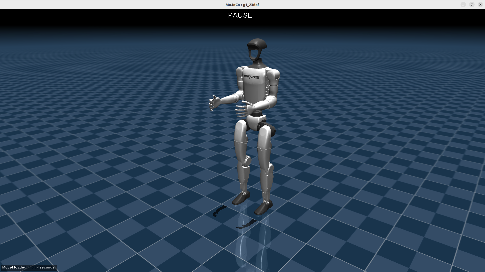
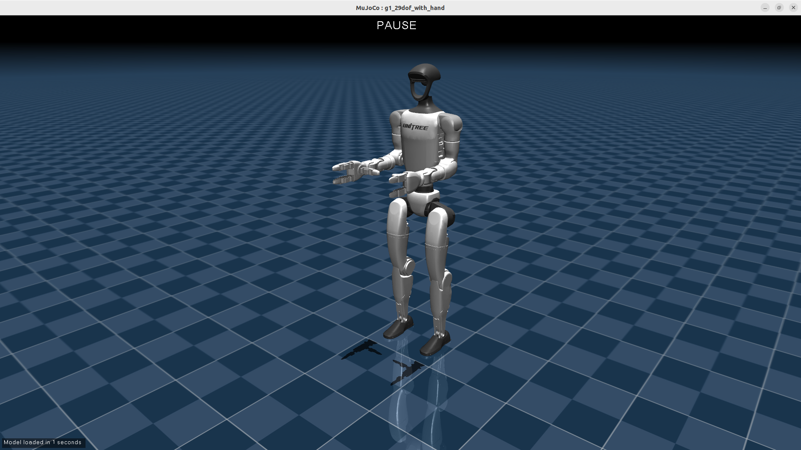
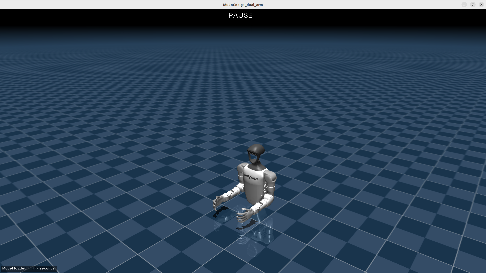

# Unitree G1 Description (URDF & MJCF)

## Overview

This package includes a universal humanoid robot description (URDF & MJCF) for the [Unitree G1](https://www.unitree.com/g1/), developed by [Unitree Robotics](https://www.unitree.com/).

<p align="center">
  
  
  
  
</p>

As shown, there are a total of 4 versions of MJCF/URDF for the G1 robot:

* `g1_23dof`
* `g1_29dof`
* `g1_29dof_with_hand`
* `g1_dual_arm`

## Visulization with [MuJoCo](https://github.com/google-deepmind/mujoco)

1. Open MuJoCo Viewer

   ```bash
   pip install mujoco
   python -m mujoco.viewer
   ```

2. Drag and drop the MJCF/URDF model file (`g1_XXX.xml`/`g1_XXX.urdf`) to the MuJoCo Viewer.

## Local modifications

`g1_23dof` is the model this stack runs on and has been changed from the
upstream Unitree description:

* An explicit `<option>` block. Gravity is stated as `-9.80665` to match
  `physics/gravity` in `g1_mujoco_sim/config/g1_locomotion.yaml`; the default
  `-9.81` would leave the plant and the controllers disagreeing about the one
  constant they both use.
* The ankle links carry four small collision spheres each instead of a
  collision mesh, in a `foot_contact` default class. Their friction must equal
  `physics/friction_coefficient`, otherwise the friction cones the controllers
  respect are not the ones the ground enforces. The simulation also sets the
  geom friction from that parameter at load time.
* The URDF adds `*_foot_line_contact_lower/upper` and `*_foot_point_contact`
  frames. The line-contact pair is what the single-rigid-body model uses as its
  four contact points; the point-contact frame is what the swing and stance
  tasks track.

The URDF and the MJCF agree: same joint order, same mass, same forward
kinematics. `g1_mujoco_sim` asserts the joint ordering at start-up, because
nothing in either format guarantees it and the two are indexed against each
other.
